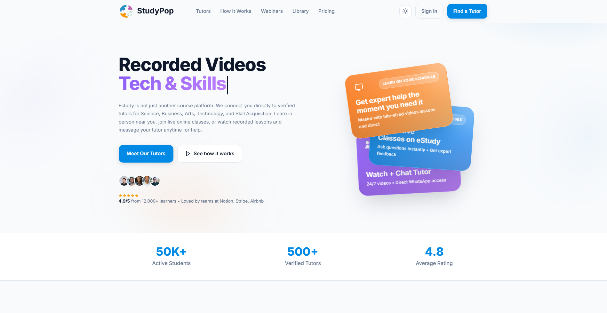

# AVENIR — Asset Investment Platform

A premium, responsive front-end prototype for an institutional real-estate investment platform. The application guides users through a polished four-stage account setup, investment preferences, location details, and final consent flow.

[](https://okeyodev.github.io/company-log-pro-mgt/)

## Preview



## About the Project

AVENIR presents an asset-management experience built around property discovery and investment onboarding. It combines a high-end institutional visual design with an interactive signup workflow that demonstrates form validation, responsive states, password feedback, and client-side demo data storage.

The project is a frontend-only prototype. It does not connect to a real authentication, payment, banking, or portfolio-management API.

## Features

- Four-step account onboarding:
  1. Account details and password-strength validation
  2. Investment intent selection
  3. Interests, country, and city selection
  4. Review and consent confirmation
- Live password-strength meter and validation rules
- Inline form errors and success states
- Accessible radio, checkbox, keyboard, and focus interactions
- Password visibility controls
- Google sign-in demo interaction
- Simulated account provisioning and generated demo account ID
- Demo sign-in page
- Responsive desktop and mobile layout
- Reduced-motion support
- Cursor-based parallax effect on the visual panel
- Local storage persistence for demonstration account data

## Tech Stack

- HTML5
- CSS3
- Vanilla JavaScript
- Google Fonts
- Inline SVG graphics

No framework, package manager, build tool, or backend is required.

## Project Structure

```text
.
├── index.html      # Main four-step signup experience
├── login.html      # Demo sign-in page
├── styles.css      # Layout, components, animations, and responsive styles
├── signup.js       # Validation, state, navigation, and interaction logic
├── Screenshot.png  # Project preview image
└── README.md       # Project documentation
```

## Getting Started

### View locally

1. Clone the repository:

   ```bash
   git clone https://github.com/okeyodev/company-log-pro-mgt.git
   ```

2. Open the project directory:

   ```bash
   cd company-log-pro-mgt
   ```

3. Open `index.html` directly in a browser, or run a local server:

   ```bash
   python -m http.server 8000
   ```

4. Visit `http://localhost:8000`.

### Live website

The deployed website is available at:

**https://okeyodev.github.io/company-log-pro-mgt/**

## Demo Data and Limitations

- Account details are stored in the browser's `localStorage` under `avenir_demo`.
- Registration and sign-in actions are simulated.
- Google sign-in only demonstrates the UI flow.
- Terms and Privacy links are placeholders.
- No sensitive financial or authentication information should be entered.
- The live project should not be used as a real financial or identity-verification system.

## Accessibility and UX

The interface includes semantic labels, visible focus states, ARIA error descriptions, keyboard-operable controls, reduced-motion handling, and touch-friendly targets.

## Author

Built by [OkeyoDev](https://github.com/okeyodev).
